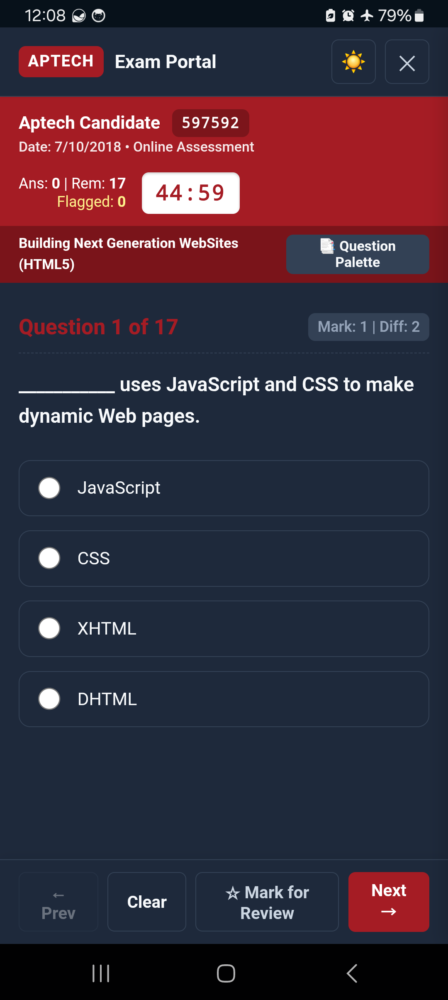
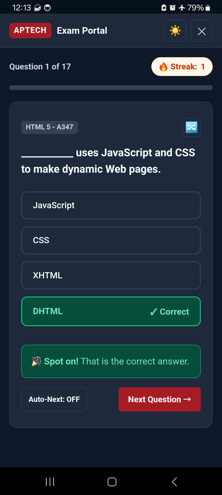
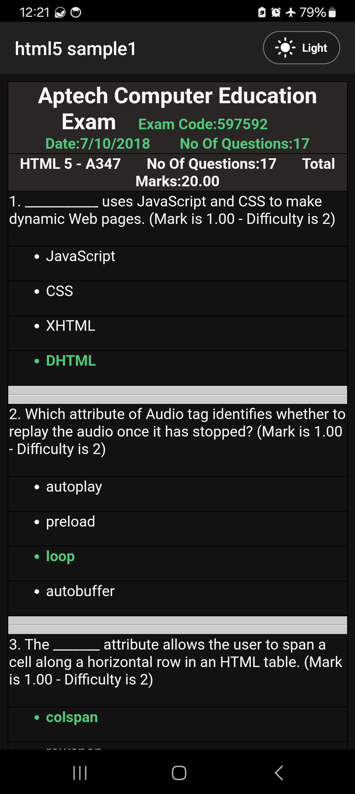
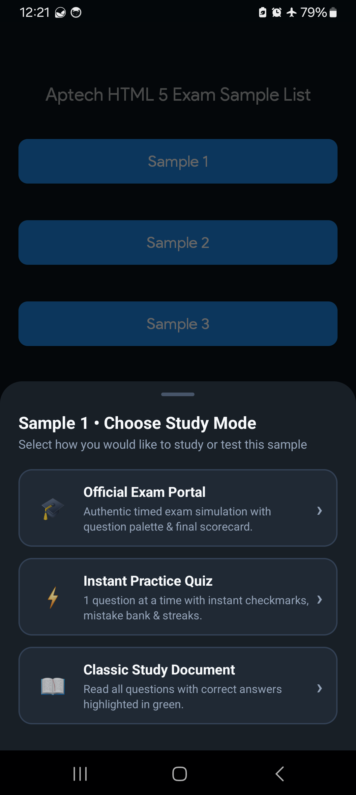
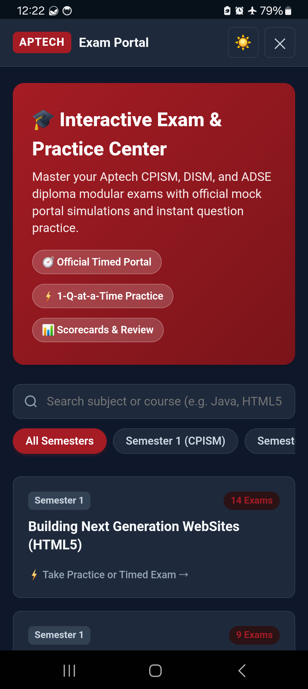

<div align="center">

# 🎓 Aptech Exam
### The Ultimate Exam Preparation & Interactive Practice Portal for Aptech Students

[-3DDC84?style=for-the-badge&logo=android&logoColor=white)](https://developer.android.com)
[](https://heshamgit.github.io/AptechExam/)
[](https://openjdk.java.net/)
[](https://gradle.org/)
[](LICENSE)
[](#offline-first-architecture)

<p align="center">
  <b>A comprehensive, open-source Android & Web study platform specifically engineered for Aptech Computer Education students pursuing CPISM, DISM, and ADSE (ACCP) diplomas.</b>
  <br>
  Featuring real-time timed exam simulations, adaptive 1-question practice with streaks, and complete verified past papers.
</p>

[🌐 Try Online (No Install)](https://heshamgit.github.io/AptechExam/) • [📥 Download Latest APK](#-download--installation) • [✨ Key Features](#-key-features) • [📱 Three Study Modes](#-three-distinct-study-modes) • [📚 Curriculum Covered](#-complete-curriculum-coverage) • [🛠️ Build from Source](#-building-from-source)

---

</div>

## 📸 App Screenshots

<div align="center">

| 🎓 Official Timed Portal | ⚡ Instant Practice Quiz | 📖 Classic Study Mode (Dark/Light) |
|:---:|:---:|:---:|
|  |  |  |
| *Real Aptech exam center UI with countdown timer, candidate meta, and question palette.* | *Instant feedback on tap, live accuracy stats, and streak counters.* | *Complete question sheets with highlighted answers and custom pill theme toggle.* |

<br>

| 📱 Modern Study Mode Picker | 🗂️ Interactive Exam Catalog |
|:---:|:---:|
|  |  |
| *Seamless Material Bottom Sheet for selecting your preferred study mode.* | *Instant search and quick launch across all 4 semesters and subjects.* |

</div>

---

## 🌐 Try Online via GitHub Pages

Don't have an Android device nearby or want to preview the exams before downloading the APK? Access the fully-functional web edition directly in your browser:

<div align="center">

[](https://heshamgit.github.io/AptechExam/)

</div>

* **⚡ Instant Browser Practice:** Complete access to all 30 semester subjects, 170+ verified past papers, timed examination modes, and instant recall drills.
* **🔒 100% Client-Side & Private:** All parsing and evaluation execute directly in your browser without telemetry, tracking, or user registration.
* **🔄 Continuous GitHub Actions CI/CD:** Any updates to question banks or exam manifests are automatically validated, packaged, and deployed to GitHub Pages via `.github/workflows/deploy-pages.yml`.

---

## ✨ Key Features

- **🎯 Authentic Aptech Exam Center Simulation:** Recreates the official Aptech exam center testing interface, complete with candidate meta headers (`#A51C24`), strict 45-minute countdown timers, multi-select checkboxes, and an interactive question palette drawer.
- **⚡ Instant 1-Question Adaptive Practice:** Perfect for rapid drill sessions. Tap any option for instant emerald checkmark verification, shake animations on mistakes, live streak counters, and performance accuracy analytics.
- **📖 Comprehensive Past Papers & Answer Keys:** Full coverage of official Aptech sample exams, question banks, and past papers with verified answer keys highlighted in emerald green (`#50C878`).
- **🌙 True Dark & Light Modes:** Hardware-accelerated WebView dark mode with a custom ActionBar pill toggle and pixel-perfect 24dp Sun/Moon vector icons.
- **🔒 100% Offline & Private:** Zero external server dependencies, zero tracking, zero telemetry, and zero ads. The entire question bank is bundled locally in assets and runs without an internet connection.
- **📱 Modern Material Design:** Conforms to modern Android UI/UX guidelines with edge-to-edge Material Bottom Sheets, tactile ripple feedback, and fluid transitions.

---

## 📱 Three Distinct Study Modes

When opening any sample exam, students can choose between three specialized modes tailored to different stages of exam preparation:

```
                              ┌─────────────────────────────┐
                              │     Sample Exam Selected    │
                              └──────────────┬──────────────┘
                                             │
             ┌───────────────────────────────┼───────────────────────────────┐
             ▼                               ▼                               ▼
  ┌─────────────────────┐         ┌─────────────────────┐         ┌─────────────────────┐
  │   Official Portal   │         │  Instant Practice   │         │    Classic Study    │
  ├─────────────────────┤         ├─────────────────────┤         ├─────────────────────┤
  │ • 45-min countdown  │         │ • 1 question drill  │         │ • All answers shown │
  │ • Question palette  │         │ • Instant checkmark │         │ • Dark/Light toggle │
  │ • Audit submission  │         │ • Streak tracker    │         │ • Printable reading │
  │ • Final scorecard   │         │ • Mistake bank      │         │ • Quick review      │
  └─────────────────────┘         └─────────────────────┘         └─────────────────────┘
```

### 1. 🎓 Official Aptech Exam Portal (Timed Simulation)
Designed to conquer exam anxiety by placing students inside the real testing environment:
- **Aptech Brand Header:** Displays candidate meta, course name, exam code, and active question index.
- **Strict 45-Minute Timer:** Live countdown with auto-submission warning at the final minute.
- **Dynamic Question Palette:** Drawer displaying status colors for every question (Answered, Flagged for Review, Visited, and Unvisited).
- **Comprehensive Scorecard:** End-of-exam evaluation providing exact score, pass/fail status (passing grade $\ge 50\%$), time elapsed, and complete review of questions with student choices vs. official keys.

### 2. ⚡ 1-Question Instant Practice Quiz
Designed for rapid memorization and active recall:
- Immediate answer evaluation upon tap with subtle haptic animations.
- Real-time 🔥 **Streak Counter** and accuracy percentage tracking.
- **Adaptive Study Tools:** Shuffle questions, auto-advance on correct answers, and instant jump to Mistake Bank.

### 3. 📖 Classic Study Document (Complete Answer Key)
Designed for in-depth revision and reading:
- Displays the complete exam paper in a high-readability responsive table format.
- Verified correct answers prominently highlighted in green bold text.
- Integrated ActionBar pill toggle for seamless dark/light theme switching.

---

## 📚 Complete Curriculum Coverage

AptechExam covers all major semester subjects across the three core Aptech Computer Education diplomas:
1. **CPISM** (*Certificate of Proficiency in Information System Management*)
2. **DISM** (*Diploma in Information System Management*)
3. **ADSE** (*Advanced Diploma in Software Engineering / ACCP*)

| Semester | Core Subject Modules Included | Exam Format |
|:---|:---|:---:|
| **Semester 1** | • Building Next Generation Websites (HTML5 / CSS3)<br>• Logic Building & Elementary Programming with C<br>• Markup Language & JSON (XML Simplified)<br>• Object-Oriented Programming Concepts (OOP)<br>• Programming Principles and Techniques<br>• SQL Server 2012 Relational Databases<br>• UI & UX for Responsive App Design<br>• Web Productivity Tools & Cloud Services | Interactive + HTML |
| **Semester 2** | • Application Programming in C# (.NET)<br>• Fundamentals of Internet of Things (IoT)<br>• Fundamentals of Java (Core Java)<br>• Linux Operating System Fundamentals<br>• Object-Oriented Programming with Java (Java OOP)<br>• Online Advertising & Digital Management<br>• Search Engine Optimization (SEO) | Interactive + HTML |
| **Semester 3** | • Agile SDLC for Modern Software Projects<br>• Architecting Applications for the Web<br>• Introduction to Web & Enterprise Applications<br>• Web Component Development with Java (Servlets & JSP) | Interactive + HTML |
| **Semester 4** | • Creating Services for the Web (Java Web Services / REST)<br>• Developing Mobile Applications using Android<br>• Enterprise Application Development using EJB<br>• Advanced Querying with MySQL<br>• Rich Internet Applications with AJAX & Java<br>• Software Engineering Principles<br>• Software Project Management (SPM)<br>• Testing Android Applications & QA Automation<br>• Web Application Development with PHP & Apache | Interactive + HTML |

---

## 📥 Download & Installation

### Option 1: Direct APK Download (Recommended)
Grab the latest signed production APK directly from the [Releases](https://github.com/HeshamGit/AptechExam/releases) section:
1. Download `AptechExam-release.apk`.
2. Open the file on your Android device.
3. If prompted, allow installation from unknown sources.
4. Launch and begin practicing offline immediately.

### Option 2: Install via ADB (Developers)
```bash
adb install -r AptechExam-release.apk
adb shell am start -n com.mountaineers.myapplication/.activities.MainActivity
```

---

## 🛠️ Building from Source

### Prerequisites
- **JDK:** OpenJDK 11 (`C:\Program Files\Java\jdk-11.0.16` or Android Studio bundled `jbr`).
  > **Note:** Gradle 7.0.2 requires Java 11. Java 17+ will cause build failures.
- **Android SDK:** API Level 31 (Android 12), Build-Tools 30.0.3+.

### 1. Clone the Repository
```bash
git clone https://github.com/HeshamGit/AptechExam.git
cd AptechExam
```

### 2. Configure SDK Path
Ensure `local.properties` contains your local Android SDK location:
```properties
sdk.dir=C:\\Users\\YOUR_USERNAME\\AppData\\Local\\Android\\Sdk
```

### 3. Build Debug APK
```powershell
# Set Java 11 environment
$env:JAVA_HOME = "C:\Program Files\Java\jdk-11.0.16"

# Build debug APK
.\gradlew assembleDebug
```
The output APK will be generated at `app/build/outputs/apk/debug/app-debug.apk`.

### 4. Build Signed Production Release APK
```powershell
# Build unsigned release APK
.\gradlew assembleRelease

# Sign using apksigner with Android V1 + V2 signatures
$apksigner = (Get-ChildItem -Path "$env:LOCALAPPDATA\Android\Sdk\build-tools" -Filter apksigner.bat -Recurse | Select-Object -First 1).FullName
& $apksigner sign --ks "path\to\your_keystore.jks" --ks-key-alias your_alias --out app/build/outputs/apk/release/app-release.apk app/build/outputs/apk/release/app-release-unsigned.apk
& $apksigner verify --verbose app/build/outputs/apk/release/app-release.apk
```

---

## 🏗️ Technical Architecture & Quality Standards

- **Hardware-Accelerated WebView Engine:** High-performance web rendering with bidirectional JavaScript communication through [`AndroidBridge.java`](app/src/main/java/com/mountaineers/myapplication/activities/InteractivePortalActivity.java).
- **Clean Security Hygiene:** All internal activities are strictly configured with `android:exported="false"` in [`AndroidManifest.xml`](app/src/main/AndroidManifest.xml) to eliminate attack surfaces and adhere to Google Play Store best practices.
- **Zero Double-Click Bubbling:** Custom option selector event dispatching in [`portal.js`](app/src/main/assets/portal/portal.js) eliminating synthetic mobile click re-triggering.
- **Native Material Components:** Uses Google Material Design 1.4+ bottom sheet dialogs, vector drawables, dynamic DayNight theming, and responsive view binding.

---

## 🤝 Contributing

Contributions to expand the exam database or improve practice features are welcome!

1. Fork the Project.
2. Create your Feature Branch (`git checkout -b feature/AddSubjectSample`).
3. Add clean HTML sample exams in `app/src/main/assets/{subject}/sample{N}.htm`.
4. Register the new sample in [`SampleExamActivity.java`](app/src/main/java/com/mountaineers/myapplication/activities/SampleExamActivity.java).
5. Commit your changes (`git commit -m "feat(exams): add XML sample 5 with verified answer keys"`).
6. Push to your branch (`git push origin feature/AddSubjectSample`).
7. Open a Pull Request.

---

## 📄 License

Distributed under the MIT License. See [`LICENSE`](LICENSE) for more information.

---

## 🌟 Support

If this app helps you succeed in your Aptech semester exams, please give the repository a **Star ⭐** to help other students discover it!

<div align="center">
  <sub>Built with ❤️ for the Aptech Computer Education student community worldwide.</sub>
</div>
